  

 

 

## Sobre mí

Estudiante de octavo semestre de Ingeniería de Sistemas en la Corporación Universitaria Remington. Me interesa el desarrollo de software de punta a punta: diseñar el modelo de datos, construir la API, la interfaz y dejarlo funcionando. Busco una práctica profesional que inicie en enero de 2027, de preferencia en Medellín o el Valle de Aburrá.

## Tecnologías

<table>
<tr>
<td width="170"><b>Lenguajes</b></td>
<td></td>
</tr>
<tr>
<td><b>Backend</b></td>
<td></td>
</tr>
<tr>
<td><b>Frontend</b></td>
<td></td>
</tr>
<tr>
<td><b>Datos</b></td>
<td></td>
</tr>
<tr>
<td><b>Infraestructura y herramientas</b></td>
<td></td>
</tr>
</table>

## Proyectos destacados

<table>
<tr>
<td width="50%" valign="top">

### [Inventia](https://github.com/JuanCrespoAldana/inventia)

Sistema web multisede de gestión de inventarios con predicción de demanda para PyMEs. Proyecto de grado.

</td>
<td width="50%" valign="top">

### [Sistema de Inventario para Taller](https://github.com/JuanCrespoAldana/Sistema-Inventario-Taller)

Aplicación web para ventas, reparaciones, inventario y reportes de un taller real, hecha con Laravel.

</td>
</tr>
</table>

## Lenguajes más usados

 

Medellín, Colombia · juancrespoaldana@gmail.com

